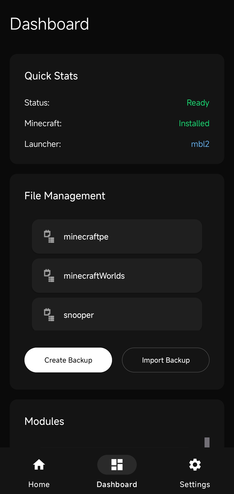
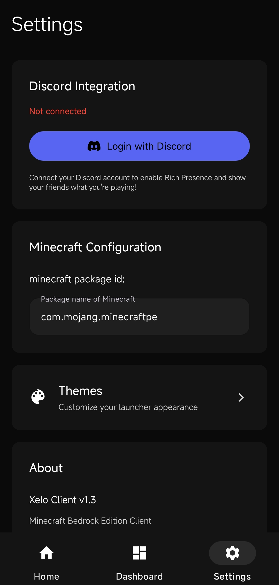
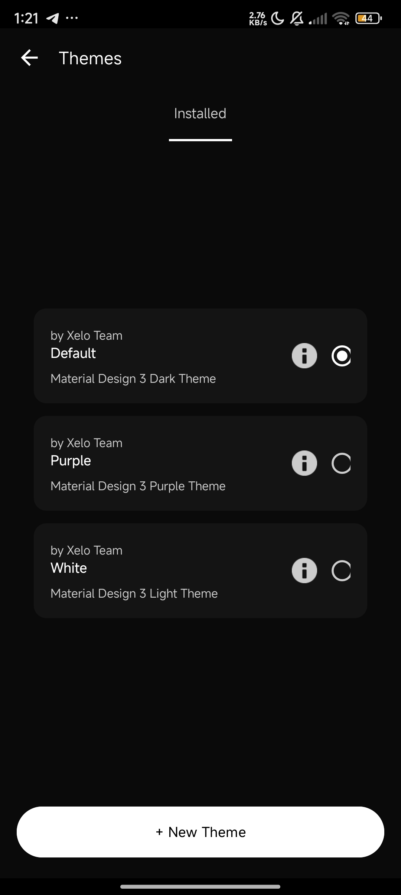

  

  
  

 
 

**Henshin Client** is an advanced minecraft bedrock client for __android__ designed for pvpers, survival players, builders etc. Henshin has alot of features and a crazy fps boost

> **We are looking for contributors/maintainers to help keep the project alive and speed up the development. You can help by fixing bugs, implementing & improving features, etc.**

## New in this version
  - [x] New launcher UI: only 3 pages - **Account**, **Home**, **Settings**
  - [x] Module system with typed values (Bool, Int, Float, Enum, Text, Color) saved per module
  - [x] Modules: **Killaura** (Combat), **Spider** (Movement), **ItemEsp** (Render), **AutoEat** (Player), **Desync** (Misc)
  - [x] Two in-game ClickGUIs (Panel / Toolbox), switch them in Settings
  - [x] Floating shortcut buttons: place them anywhere, tap to toggle a module
  - [x] Chat commands (never sent to the server): `.bind Killaura Z`, `.unbind`, `.binds`, `.toggle`, `.set <module> <value> <x>`, `.shortcut add|remove|edit|clear`, `.gui`, `.help`

> Killaura falls back to tapping the crosshair and AutoEat to a timer when the native game bridge (`libhenshin_core.so`) is not packaged.
> Spider, ItemEsp and Desync need that bridge (game memory access) to do anything.

## Features
  - [x] Integrated launcher
  - [x] Export & Import backup system
  - [x] Clean material you 3 ui design
  - [x] Export & Import config system
  - [X] Launcher based modules
  - [x] Discord RPC
  - [x] Community made themes support
  - [x] Log preview
  - [x] Shader support(materialbinloader2)
  - [x] Fullbright
  - [x] Nohurtcam
  - [x] No fog
  - [x] Optimizations(particles, shadows, etc)
  - [x] AMOLED Theme
  - [x] In game ClickGUI (toolbox style, Right Shift or floating button)
  - [x] Auto Clicker (adjustable CPS)
  - [ ] version manager/installer
  - [ ] Cosmetics
  - [x] Options.txt editor
  - [x] Device info(arch, ram, model, etc)
  - [x] Commits preview
  

 

## Community
> [!TIP]
Join the Henshin-Client community to stay updated and engage with other users:
- [website](https://xeloclient.in)
- [Discord](https://dsc.gg/xelo)

 

## Download

  
  </a>

 

- **Latest Alpha Build**: Download from [Actions](https://github.com/Xelo-Client/Xelo-Client/actions/)
- **Latest Stable Build**: Download from [Releases](https://xeloclient.in)

 

## Screenshots

  
  
  

  
  

## Contributing

We welcome contributions! Please read the [CONTRIBUTING.md](/docs/CONTRIBUTING.md) file to learn how you can get involved.

## Get Involved

Contribute themes/capes for Xelo! join [discord](https://dsc.gg/xelo) to get involved:

  
## Like this client? ❤️
Support it by giving a star ⭐  
Also, **__[follow](https://github.com/Xelo-Client)__** me for our next creations!

## Contributors
 
